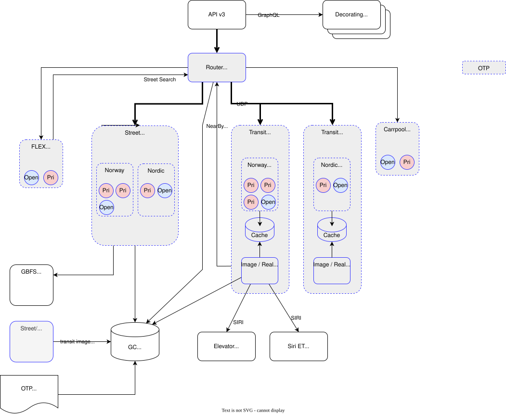

# Architecture OTP v3

## Goals

### Improve maintainability & development speed

Splitting OTP into multiple components will reduce complexity and some of the code can be maintained
by different people/teams. This forces us to define clear interface and boundaries between the
components. This will help developers and AI to understand and maintain the code. NOT EVERYTHING
IS EQUALLY IMPORTANT. At Entur we can focus on the parts of OTP that matter to us, and not have to
worry about other parts (fares, sandbox modules).

Today the core OTP developers need to spend time on issues that is irrelevant to them, and 
everything needs to have the same quality guard. In OTP there are almost 500 thousand lines of code.
This was 110 thousand lines in 2020 (OTP was started in 2009). Smaller components are
easier and faster to test, understand and maintain. 

The first step is to split OTP into _logical_ components - keeping it as one big runnable. But 
splitting it into multiple runnables will enforce clear APIs and boundaries, and allow us to 
swap/replace components - like a new Transit reference API with more information and access to 
historic data. It will also allow to let Entur decorate the routing API with extensions without
allocating CORE OTP developers time _(e.g. Emissions & Empirical Delay)_.

At the recent OTP Summit in Bern 12 Core OTP developers attended. By splitting the code we can also
split the group of developers into smaller team and work more efficient. Some developers will still
work on "everything", but some can focus on specific components. OTP is complex, and needs 
specialists, it takes a long time to understand the code and the domain.

### Performance & scalability

We know there are a lot to gain in increasing the performance of OTP. We want:

 - Scale beyond Norway to Nordic and Europe.
 - Reduce Hardware cost
 - Protect us against DDoS attacks by faster startup.

Recent improvement in performance show how much we can save. [TODO: Insert some numbers]
We should be able to start a transit router in seconds, not minutes [TODO: OTP Startup time].   

Cost is the number one argument for new organizations considering using OTP. For every European 
organization we can onboard, we get synergies in shared OTP development, help and collaborations
at all levels(standardization, data quality, more?). [TODO: Verify with Brede]

Today OTP is a monolithic application, and pushing everything through it is not going to scale
forever. Allowing to split up the routing, will also allow us to split the data pipelines for both
planned data and real-time data.

### New features and ways to travel

To meet new ways to travel a pluggable architecture will allow experiments in a much better way 
than today's Sandbox model. The Sandbox has been a success since introduced in 2019. In the 
suggested architecture below, a routing orchestrator should have a standard API so new routers 
can be plugged in. This will allow rapid experiments and at the same time protect the core
business - the scheduled transit routing. Today adding new features like FLEX, Carpool, and
supporting sales in Sweden/Denmark is a challenge without degrading the core business.

### Deployability & operations

OTP is today vulnerable to DDoS attacks, and the standard tools for scaling and load balancing are
not a good fit. To find a better solution, not having to run many parallel pipelines(data and 
operations) would be a big win.

## Components

Each chapter below describes one box in the diagram. Descriptions are a first draft based on
[ScalingOTP.md](../_notes/design/scaling/ScalingOTP.md) and the diagram labels. Items marked _(open)_ are not decided.

### GraphQL API v3

The public entry point. Exposes the routing and model APIs (GraphQL). It holds
no routing logic and no data. It maps API requests to the Router Orchestrator and maps the results
back. Stateless, so it can scale with request load.

**Responsibilities**

- Serve the GraphQL schema for routing and Transmodel reference APIs.
- Decorate the routing request with reference information (see [Decorating Services](#decorating-services)):
  - Transmodel (NeTEx) reference information
  - Emissions
  - etc.
- Validate requests and map them to the internal request model.
- Map internal results back to the API model.
- Error mapping.

### Decorating Services

Services that add information to requests and itineraries.

**Responsibilities**

- Add reference data, such as Transmodel (NeTEx) data, emissions, fares and booking info.
- Let a service fail without failing the request.

### Router Orchestrator (Part of OTPv3)

Coordinates a routing request across the other components.

#### Open questions
- How we should do rollout of new data and new OTP versions is not yet analyzed.
- Redundancy & failover

**Responsibilities**

- Split a request into access/egress street searches, transit search, and flex/carpool searches.
- Validate requests and map them to the internal request model.
- Call the Street Router, Transit Router, Flex Router and Carpool Router, and merge the results.
- Routing. Split requests and route to the proper router.
  - Direct street/flex/carpool routing
  - Access/egress, then transit routing
- Build itineraries from the merged results and run the itinerary filter chain.
- Map internal results back to the API model.
- Non-functional responsibilities:
  - Load balancing and node scaling
    - Reserve nodes for high-priority clients. This should prevent DDoS attacks from untrusted
      clients.
  - Error mapping
  - Request logging
  - Pin one real-time snapshot for the whole request. A request can take 15 s while real-time
    produces 7-8 snapshots in that time. _(open: how to implement)_
  - Handle timeouts and partial failures of the called components.

### Transit Router Deployment (Part of OTPv3)

Runs the Transit Routers using a Raptor search. At startup, an image with the static scheduled
timetables is created and put in the cache. A real-time adapter is started for each deployment. It
creates a real-time data snapshot and puts it in the cache. Then the routers start and fetch the
latest snapshot. The routers register with the Orchestrator and wait for requests. They pull in the
latest real-time snapshot when one is available. The routers and the Orchestrator communicate to
use the routers well, reduce latency, and scale up and down. The Orchestrator throttles
unauthorized clients and gives authorized clients priority.

> NOTE! The transit router search does not scale well. The performance depends on the data size. This
>       means that we might split it into multiple routers based on trip patterns using the
>       HyperRaptor algorithm.

#### Transit Router

**Responsibilities**

- Run the Raptor search on the transit data.
- Hold the timetables and transfers in memory, in compact arrays.
- Load the transit image produced by the Graph Builder.
- Read real-time updates from the Siri ET Realtime Cache.
- Use transfers from Nearby Transfers. Needs no street data.
- Scale up and down fast (seconds). Candidate for serverless or stateless scaling. _(open)_
- Run per region and for the whole deployment. Most requests fit in one region. Long requests go
  to the instance with "everything". _(open)_

#### Image / Real-time Adapter

Applies SIRI ET (and SX) and other real-time updates to the transit data and publishes the result
as real-time snapshots in the Transit Cache. The routers fetch these snapshots instead of applying
the updates themselves. Applying real-time updates is a small part of the CPU and memory load today.
The alternative is to keep real-time handling inside the routers. Some benefits might be:

- **Simple snapshot model.** The cache could be just a double-buffered snapshot. And each router
  will fetch at most N concurrent snapshots, and roll over when a snapshot is no longer used by a
  concurrent request.
- **Fast start and scale-out.** A new router fetches a ready snapshot from the cache, and does not
  need to catch up on the real-time feed.
- **Leaner routers.** Validating and mapping updates needs more information than the routers need to
  search (for example the full trip and stop pattern data). Routers can be small, simple 
  light-weight components.

**Responsibilities**

- At startup:
  - Fetch config and heuristics.
  - Load the transit image produced by the Graph Builder.
  - Create the static scheduled timetables and transfers image to initialize the routers.
- Read SIRI ET and SX from the Siri ET Realtime Cache, and other real-time data from the
  producers (subscription, polling or Pub/Sub).
- Validate messages and map them to the OTP model.
- Update the real-time snapshot and put it in the Transit Cache for the routers to use.
- Fetch and build new transfers as needed based on real-time updates.

#### Transit Cache

The cache inside each transit deployment. It is the link between the adapter and the routers.

**Responsibilities**

- Store the static timetable image and the latest real-time snapshots.
- Let the routers fetch the latest snapshot at startup and when a new one is available.
- Give new routers fast start-up, without each router building its own data.

### Street Router Deployment (Part of OTPv3)

Runs the Street Routers. At startup, each router loads the streetGraph from GC Storage into memory
and links to the GBFS Gateway for vehicle rental and parking data. The routers register with the
Orchestrator and wait for requests. The Orchestrator sends access, egress and direct street
searches to them. A street graph is large, but it scales well so we might only need one big graph.
We need to analyze how we want to set this up - HW cost is the main driving factor. Options are:
One big graph and enough instances to serve all requests, or a Norway and a Nordic set of instances
to be able to scale up/down faster and use less resources. The request/response times are not
necessarily much higher for a local search (inside Oslo/Akershus) on the Nordic compared with a
Norway instance.

#### Street Router

Runs street search (walk, bike, car) for access, egress and direct routes. The street graph is large
(~60 GB at GB/Germany scale), so instances are stateful and sized by graph size.

**Responsibilities**

- Answer street routing requests for walk, bike and car, using A\* search with the heuristics and
  config from OTP Heuristics/Config.
- Search from one origin to many stops (access/egress) and from point to point (direct).
- Search for transfers between stop pairs when real-time updates require new transfers.
- Can also potentially be used by the Flex Router and Carpool Router for their street searches.
  _(open)_
- Hold the street graph in memory, loaded from the street image produced by the Graph Builder.
- Apply street-related real-time data: vehicle rental and parking from the GBFS Gateway.

### Flex Router Deployment (Part of OTPv3)

Runs the Flex Routers. The Orchestrator sends requests for flexible transit (area-based and
on-demand service) to them. A flex router may hold its own street graph or use the StreetRouter
_(open)_.

#### Flex Router

**Responsibilities**

- Find flex access, egress and direct routes.
- May use the Orchestrator for street search.
- Return flex results in a form the Orchestrator can merge with the Transit Router results.

### Carpool Router Deployment (Part of OTPv3?)

Runs the Carpool Routers. The Orchestrator sends requests for carpooling to them.

### Siri ET Realtime Cache (Existing)

Holds the current real-time state of trips, as received from the SIRI ET feed. The Image / Real-time
Adapters read from it, so the update work is done once and not in every router. No change from
today's setup.

### Elevator Realtime Cache (New)

Holds the status of elevators and escalators.

### GBFS Gateway (Existing)

Reads GBFS feeds so the routing instances do not have to. The Street Router Deployment reads from it.

### Street/Transit Graph Builder (Part of OTPv3)

Offline build step. Reads OSM and NeTEx (and elevation data) and produces two images: the **transit
image** and the **street image**. The street graph can stay unchanged, but we might change the
transit graph. The Image/RealTime Adapter and the router nodes may need different data from the
transit graph.

**Responsibilities**

- Read and validate OSM, NeTEx and elevation data.
- Build the street image and the transit image.
- Write both images to GC Storage.
- Keep the two images consistent (stop links, transfers).
- Trigger roll-over: a new transit image only restarts the Transit Router Deployment; a new street
  image, or a new OTP version, can restart the whole cluster.

### GC Storage

Google Cloud storage bucket that holds the built images and the config.

### OTP Heuristics/Config

- OTP configuration for the cluster _(otp_, build-, router-config)_.
- Shared heuristics for the routers _(New)_.

> Use-case heuristics! We do not have this today, but many optimizations in OTP could benefit from
> heuristic data. One example is min travel-time/cost distribution numbers between stop clusters.
> This would allow us to guess the search-window more accurately and find the right amount of results
> in the first request, with less paging.
